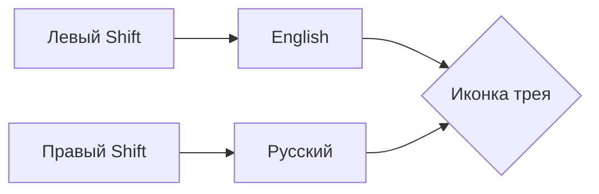

# YALangSwitcher

**Yet another language switcher.** Один exe в трее, который делает ровно одну вещь: <kbd>левый Shift</kbd> — English, <kbd>правый Shift</kbd> — Русский. Работает и в приложениях, запущенных от имени администратора.

Никаких .NET, Avalonia, CGO и зависимостей: чистый Win32 через `syscall`, один файл ~6 МБ, ~18 МБ памяти в покое и 0 % CPU.

---

## Зачем

Стандартное переключение раскладки — это `Alt+Shift` или `Win+Space`, которые надо помнить, а на ощупь они неочевидны. Здесь роль переключателя играют сами Shift-клавиши:

| Клавиша | Что происходит |
| --- | --- |
| Левый <kbd>Shift</kbd> | раскладка переключается на **English** (`00000409`) |
| Правый <kbd>Shift</kbd> | раскладка переключается на **Русский** (`00000419`) |
| <kbd>Shift</kbd> + буква | ничего не переключается, `Shift` работает как обычно |
| <kbd>Ctrl</kbd>/<kbd>Alt</kbd>/<kbd>Win</kbd> + <kbd>Shift</kbd> | игнорируется |
| <kbd>Shift</kbd> + клик мышью | игнорируется (это выделение текста) |

Иконка в трее — это ещё и индикатор: синяя **A** висит, когда активен English, красная **Я** — когда Русский.



---

## Как это работает

```text
WH_KEYBOARD_LL hook  →  состояние Shift  →  WM_INPUTLANGCHANGEREQUEST  →  активное окно
                              ↓                        (DefWindowProc активирует HKL)
                    не сработало?  →  SendInput Alt+Shift как запасной путь
```

- **Хук низкого уровня**, а не `RegisterHotKey`: Shift не «съедается», другие программы его видят, а мы только наблюдаем.
- **Переключение через `WM_INPUTLANGCHANGEREQUEST`** — это официальный способ попросить чужое окно сменить раскладку: сообщение обрабатывает `DefWindowProc` в потоке приложения, и раскладка меняется именно там, где стоит курсор.
- **Проверка результата.** Через 120 мс приложение смотрит на реальный `HKL` активного окна. Если окно сообщение проигнорировало (некоторые игры и самописные тулкиты), отправляется системный хоткей из `fallbackHotkey` (`Alt+Shift` по умолчанию) — столько раз, сколько нужно до нужной раскладки в цикле.

> [!IMPORTANT]
> Хук видит нажатия, адресованные окнам **с более высокими правами**, только если сам процесс запущен с повышенными правами. Поэтому по умолчанию приложение живёт с правами администратора: UAC спрашивается один раз при первом запуске, дальше автозапуск идёт через задачу планировщика без единого запроса.

---

## Установка

1. Скачать `YALangSwitcher.exe` из [Releases](../../releases).
2. Положить в постоянную папку, например `%LOCALAPPDATA%\Programs\YALangSwitcher\` (не в `Temp`: путь прописывается в автозапуск и в задачу планировщика).
3. Запустить. Один раз подтвердить UAC — приложение перезапустится с правами администратора, создаст задачу планировщика и включит автозапуск.
4. При желании вытащить иконку из «переполнения» трея: Windows 11 прячет новые иконки, приложение само ставит себе `IsPromoted=1`, но иногда это срабатывает только после перезапуска Explorer.

Удаление: меню трея → «Выход», затем удалить exe и задачу `YALangSwitcher` в Планировщике заданий (или выключить автозапуск в меню перед удалением).

---

## Меню трея

| Пункт | Что делает |
| --- | --- |
| `Сейчас: English/Русский` | текущая раскладка активного окна |
| `Запускать при входе в Windows` | автозапуск: задача планировщика в режиме админа, иначе ключ `HKCU\...\Run` |
| `Запуск с правами администратора` | перезапуск с UAC и перевод автозапуска на задачу планировщика |
| `Проверить обновления` / `Установить обновление X` | ручная проверка GitHub Releases |
| `Открыть папку программы` / `Открыть лог` | путь к exe и лог |
| `О программе` | версия, режим, права, автозапуск, пути |
| `Выход` | завершение работы |

Меню открывается левым и правым кликом по иконке.

---

## Настройки

`%APPDATA%\YALangSwitcher\config.json` — создаётся при первом запуске, правится и вручную (приложение читает его при старте).

```json
{
  "englishLayout": "00000409",
  "russianLayout": "00000419",
  "mode": "tap",
  "fallbackHotkey": "alt+shift",
  "autostart": true,
  "adminMode": true,
  "autoUpdate": true,
  "updateCheckHours": 6,
  "notifications": true
}
```

| Ключ | Значения | Смысл |
| --- | --- | --- |
| `englishLayout` / `russianLayout` | KLID | какие раскладки считать английской и русской |
| `mode` | `tap` / `down` | `tap` — переключать при отпускании одиночного Shift (не мешает `Shift+буква`), `down` — сразу по нажатию |
| `fallbackHotkey` | `alt+shift`, `ctrl+shift`, `win+space`, `none` | чем дублировать переключение, если окно проигнорировало сообщение |
| `autostart` | bool | автозапуск при входе |
| `adminMode` | bool | запуск с правами администратора (нужно для elevated-приложений) |
| `autoUpdate` | bool | проверять обновления при старте и раз в `updateCheckHours` |
| `notifications` | bool | всплывающие уведомления |
| `acceptInjected` | bool | реагировать на синтезированные нажатия (только для тестов/AutoHotkey) |

Лог: `%APPDATA%\YALangSwitcher\yalangswitcher.log` (ротация на 512 КБ).

---

## Сборка

Нужен Go 1.24+ и `go-winres` (только для иконки, версии и манифеста):

```bash
go install github.com/tc-hib/go-winres@latest
make build VERSION=0.1.0     # → build/YALangSwitcher.exe
make icon                    # перегенерировать assets/*.ico (если правили иконку)
```

Иконки рисуются кодом (`internal/icon`): `assets/icon-en.ico`, `assets/icon-ru.ico` — бейджи для трея, `assets/app.ico` — иконка файла. Поэтому иконка всегда одинаковая на любом DPI, а в репозитории лежат уже собранные `.ico`.

---

## CI, релизы и автообновление

`.github/workflows/build.yml` на каждый push в `main`:

1. `gofmt` + `go vet` под `windows/amd64`;
2. версия = `0.<количество коммитов>.0`, сборка exe;
3. публикация **обычного** релиза `vX.Y.Z` с ассетом `YALangSwitcher.exe`.

Приложение раз в `updateCheckHours` дергает `api.github.com/repos/dvygolov/YALangSwitcher/releases/latest`, сравнивает версию, скачивает exe, подменяет файл (`rename` + `copy`) и перезапускается. Draft и prerelease релизы `/latest` не отдаёт, поэтому релиз из CI — всегда полноценный.

> [!NOTE]
> Установленная вручную dev-сборка с версией `0.0.0-dev` тоже обновится: `0.0.0` меньше любого `0.N.0`.

---

## Структура

```tree
YALangSwitcher/
├── main.go                  # окно, трей, меню, жизненный цикл
├── switcher.go              # состояние Shift + переключение раскладки
├── config.go                # config.json
├── install.go               # автозапуск: задача планировщика / Run-ключ
├── update.go                # self-update с GitHub Releases
├── log.go
├── assets/                  # сгенерированные .ico
├── internal/icon/           # рендер бейджей и запись .ico
├── internal/win/            # Win32: окно, трей, хук, реестр, SendInput
├── tools/genicon/           # генератор assets/*.ico
└── .github/workflows/build.yml
```

---

## Если что-то не так

| Симптом | Причина и решение |
| --- | --- |
| Не переключается в программе от администратора | приложение запущено без прав: меню → «Запуск с правами администратора» |
| Не переключается в игре/самописном приложении | окно игнорирует `WM_INPUTLANGCHANGEREQUEST`; включите `fallbackHotkey` (`alt+shift`) в конфиге |
| Не появилась иконка в трее | она в «переполнении» `^`: перетащите на панель или перезапустите Explorer |
| Переключается на каждом Shift | установите `"mode": "tap"` (значение по умолчанию) |
| Автозапуск не сработал | в логе ищите `autostart:`, проверьте задачу `YALangSwitcher` в Планировщике заданий |
| Ничего не понятно | `%APPDATA%\YALangSwitcher\yalangswitcher.log` |
